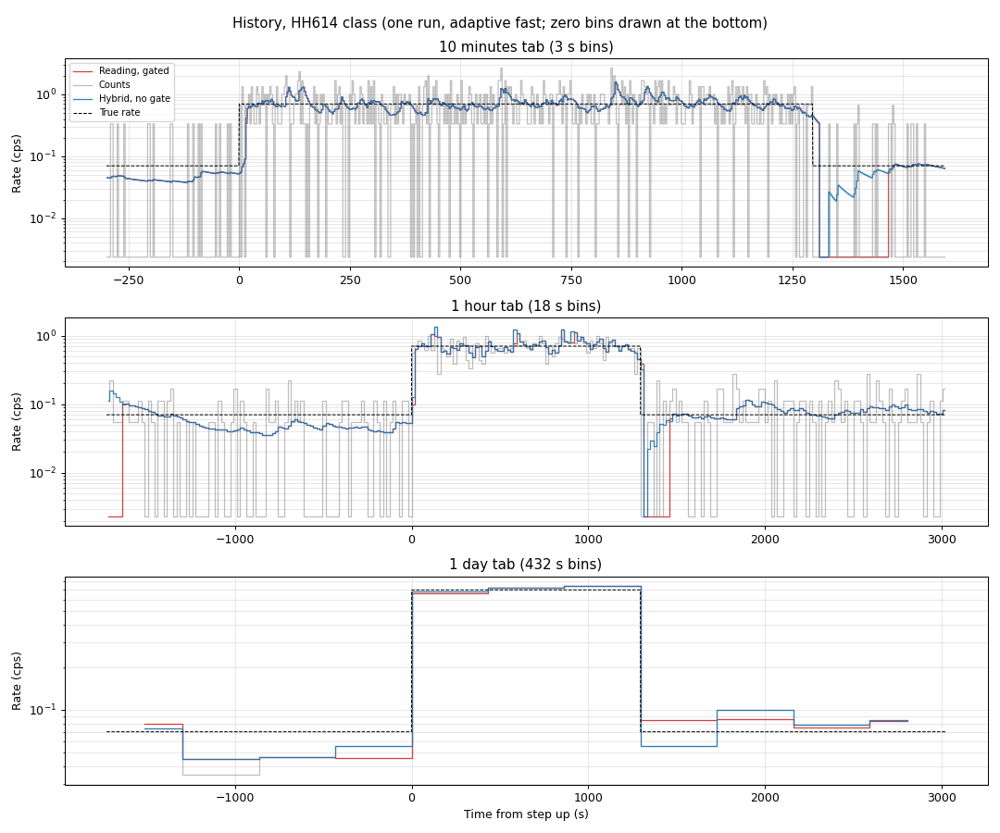
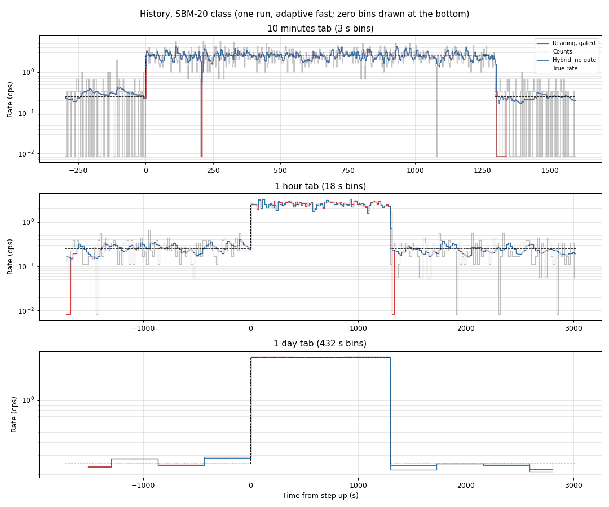
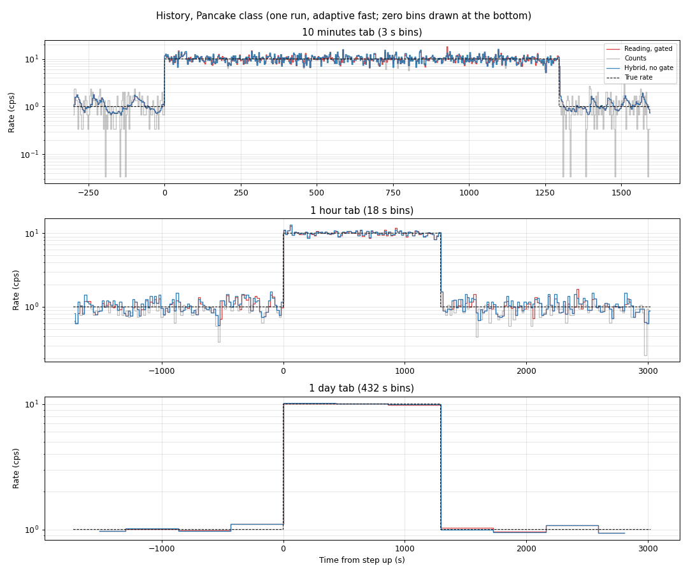

# History bins

Generated by `simulate.py --history`. Instantaneous rate with change detection (G > 22). Methods: **Reading** = the reading averaged over the bin (current firmware), **gated** = only seconds with confidence below +/-75%; **Counts** = pulses / bin length; **Hybrid** = counts for bins with at least 20 pulses, the averaged reading otherwise. Bin lengths for the 201-bin color layout.

## Steady state

Per bin: bias (mean / true rate - 1), scatter (standard deviation of bin / true rate), and empty bins (bins that read 0, the "comb" at low count rates).

### 10 minutes tab (3 s bins)

| Mode | Method | 0.07 cps | 0.25 cps | 1 cps | 10 cps |
|---|---|---|---|---|---|
| fast | Reading, gated | -0.1% / 23% / 0% | +0.5% / 23% / 0% | -0.2% / 23% / 0% | -0.8% / 16% / 0% |
| fast | Reading, no gate | +0.0% / 25% / 0% | +0.5% / 23% / 0% | -0.2% / 23% / 0% | -0.8% / 16% / 0% |
| fast | Counts | +0.1% / 219% / 81% | +0.1% / 116% / 47% | +0.0% / 58% / 5% | -0.0% / 18% / 0% |
| fast | Hybrid, gated | -0.1% / 23% / 0% | +0.5% / 23% / 0% | -0.2% / 23% / 0% | +0.3% / 18% / 0% |
| fast | Hybrid, no gate | +0.0% / 25% / 0% | +0.5% / 23% / 0% | -0.2% / 23% / 0% | +0.3% / 18% / 0% |
| precision | Reading, gated | -0.2% / 12% / 0% | +0.1% / 10% / 0% | -0.0% / 10% / 0% | -0.0% / 9% / 0% |
| precision | Reading, no gate | +0.0% / 15% / 0% | +0.1% / 10% / 0% | -0.0% / 10% / 0% | -0.0% / 9% / 0% |
| precision | Counts | +0.1% / 219% / 81% | +0.1% / 116% / 47% | +0.0% / 58% / 5% | -0.0% / 18% / 0% |
| precision | Hybrid, gated | -0.2% / 12% / 0% | +0.1% / 10% / 0% | -0.0% / 10% / 0% | +0.7% / 17% / 0% |
| precision | Hybrid, no gate | +0.0% / 15% / 0% | +0.1% / 10% / 0% | -0.0% / 10% / 0% | +0.7% / 17% / 0% |

### 1 hour tab (18 s bins)

| Mode | Method | 0.07 cps | 0.25 cps | 1 cps | 10 cps |
|---|---|---|---|---|---|
| fast | Reading, gated | -0.1% / 23% / 0% | +0.5% / 22% / 0% | -0.2% / 19% / 0% | -0.8% / 7% / 0% |
| fast | Reading, no gate | +0.0% / 23% / 0% | +0.5% / 22% / 0% | -0.2% / 19% / 0% | -0.8% / 7% / 0% |
| fast | Counts | +0.1% / 89% / 28% | +0.1% / 47% / 1% | +0.0% / 24% / 0% | -0.0% / 7% / 0% |
| fast | Hybrid, gated | -0.1% / 23% / 0% | +0.5% / 22% / 0% | +4.2% / 22% / 0% | -0.0% / 7% / 0% |
| fast | Hybrid, no gate | +0.0% / 23% / 0% | +0.5% / 22% / 0% | +4.2% / 22% / 0% | -0.0% / 7% / 0% |
| precision | Reading, gated | -0.1% / 12% / 0% | +0.0% / 10% / 0% | -0.0% / 9% / 0% | -0.0% / 7% / 0% |
| precision | Reading, no gate | +0.0% / 14% / 0% | +0.0% / 10% / 0% | -0.0% / 10% / 0% | -0.0% / 7% / 0% |
| precision | Counts | +0.1% / 89% / 28% | +0.1% / 47% / 1% | +0.0% / 24% / 0% | -0.0% / 7% / 0% |
| precision | Hybrid, gated | -0.1% / 12% / 0% | +0.0% / 10% / 0% | +8.0% / 17% / 0% | -0.0% / 7% / 0% |
| precision | Hybrid, no gate | +0.0% / 14% / 0% | +0.0% / 10% / 0% | +8.0% / 17% / 0% | -0.0% / 7% / 0% |

### 1 day tab (432 s bins)

| Mode | Method | 0.07 cps | 0.25 cps | 1 cps | 10 cps |
|---|---|---|---|---|---|
| fast | Reading, gated | -0.0% / 16% / 0% | +0.5% / 9% / 0% | -0.1% / 5% / 0% | -0.8% / 1% / 0% |
| fast | Reading, no gate | +0.0% / 16% / 0% | +0.5% / 9% / 0% | -0.1% / 5% / 0% | -0.8% / 1% / 0% |
| fast | Counts | +0.1% / 18% / 0% | +0.1% / 9% / 0% | +0.0% / 5% / 0% | -0.0% / 1% / 0% |
| fast | Hybrid, gated | +0.4% / 18% / 0% | +0.1% / 9% / 0% | +0.0% / 5% / 0% | -0.0% / 1% / 0% |
| fast | Hybrid, no gate | +0.4% / 18% / 0% | +0.1% / 9% / 0% | +0.0% / 5% / 0% | -0.0% / 1% / 0% |
| precision | Reading, gated | -0.1% / 11% / 0% | +0.0% / 8% / 0% | -0.0% / 5% / 0% | -0.0% / 1% / 0% |
| precision | Reading, no gate | +0.0% / 11% / 0% | +0.0% / 8% / 0% | -0.0% / 5% / 0% | -0.0% / 1% / 0% |
| precision | Counts | +0.1% / 18% / 0% | +0.1% / 9% / 0% | +0.0% / 5% / 0% | -0.0% / 1% / 0% |
| precision | Hybrid, gated | +0.6% / 17% / 0% | +0.1% / 9% / 0% | +0.0% / 5% / 0% | -0.0% / 1% / 0% |
| precision | Hybrid, no gate | +0.6% / 17% / 0% | +0.1% / 9% / 0% | +0.0% / 5% / 0% | -0.0% / 1% / 0% |

Cells: bias / scatter / empty bins.

## Steps (x10 up, then back down)

Time until the mean bin value stays within +/-20% of the new rate, counted from the step, in seconds (bins are aligned with the steps).

| Tube | Mode | Method | 10 minutes up | 10 minutes down | 1 hour up | 1 hour down | 1 day up | 1 day down |
|---|---|---|---|---|---|---|---|---|
| HH614 class | fast | Reading, gated | 18 s | 183 s | 36 s | 198 s | 432 s | 864 s |
| HH614 class | fast | Reading, no gate | 15 s | 48 s | 36 s | 72 s | 432 s | 864 s |
| HH614 class | fast | Counts | 153 s | - | 18 s | 1386 s | 432 s | 432 s |
| HH614 class | fast | Hybrid, gated | 18 s | 183 s | 36 s | 198 s | 432 s | 432 s |
| HH614 class | fast | Hybrid, no gate | 15 s | 48 s | 36 s | 72 s | 432 s | 432 s |
| HH614 class | precision | Reading, gated | 18 s | 183 s | 36 s | 198 s | 432 s | 864 s |
| HH614 class | precision | Reading, no gate | 15 s | 51 s | 36 s | 72 s | 432 s | 864 s |
| HH614 class | precision | Counts | 153 s | - | 18 s | 1386 s | 432 s | 432 s |
| HH614 class | precision | Hybrid, gated | 18 s | 183 s | 36 s | 198 s | 432 s | 432 s |
| HH614 class | precision | Hybrid, no gate | 15 s | 51 s | 36 s | 72 s | 432 s | 432 s |
| SBM-20 class | fast | Reading, gated | 6 s | 45 s | 18 s | 54 s | 432 s | 432 s |
| SBM-20 class | fast | Reading, no gate | 6 s | 21 s | 18 s | 36 s | 432 s | 432 s |
| SBM-20 class | fast | Counts | 3 s | 1725 s | 18 s | 18 s | 432 s | 432 s |
| SBM-20 class | fast | Hybrid, gated | 6 s | 45 s | 18 s | 54 s | 432 s | 432 s |
| SBM-20 class | fast | Hybrid, no gate | 6 s | 21 s | 18 s | 36 s | 432 s | 432 s |
| SBM-20 class | precision | Reading, gated | 6 s | 45 s | 18 s | 54 s | 432 s | 432 s |
| SBM-20 class | precision | Reading, no gate | 6 s | 21 s | 18 s | 36 s | 432 s | 432 s |
| SBM-20 class | precision | Counts | 3 s | 1725 s | 18 s | 18 s | 432 s | 432 s |
| SBM-20 class | precision | Hybrid, gated | 6 s | 45 s | 18 s | 54 s | 432 s | 432 s |
| SBM-20 class | precision | Hybrid, no gate | 6 s | 21 s | 18 s | 36 s | 432 s | 432 s |
| Pancake class | fast | Reading, gated | 3 s | 12 s | 18 s | 36 s | 432 s | 432 s |
| Pancake class | fast | Reading, no gate | 3 s | 6 s | 18 s | 36 s | 432 s | 432 s |
| Pancake class | fast | Counts | 3 s | 3 s | 18 s | 18 s | 432 s | 432 s |
| Pancake class | fast | Hybrid, gated | 3 s | 12 s | 18 s | 36 s | 432 s | 432 s |
| Pancake class | fast | Hybrid, no gate | 3 s | 6 s | 18 s | 36 s | 432 s | 432 s |
| Pancake class | precision | Reading, gated | 3 s | 12 s | 18 s | 36 s | 432 s | 432 s |
| Pancake class | precision | Reading, no gate | 3 s | 6 s | 18 s | 36 s | 432 s | 432 s |
| Pancake class | precision | Counts | 3 s | 3 s | 18 s | 18 s | 432 s | 432 s |
| Pancake class | precision | Hybrid, gated | 3 s | 12 s | 18 s | 36 s | 432 s | 432 s |
| Pancake class | precision | Hybrid, no gate | 3 s | 6 s | 18 s | 36 s | 432 s | 432 s |

