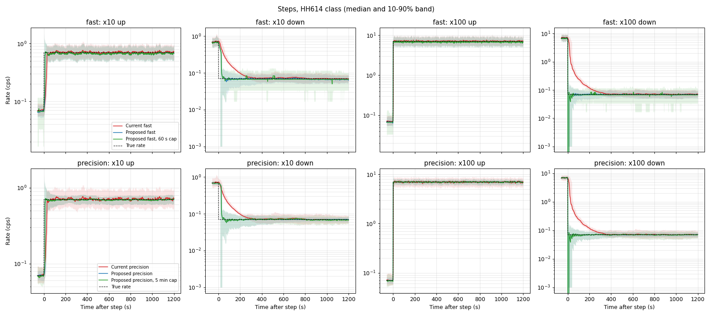
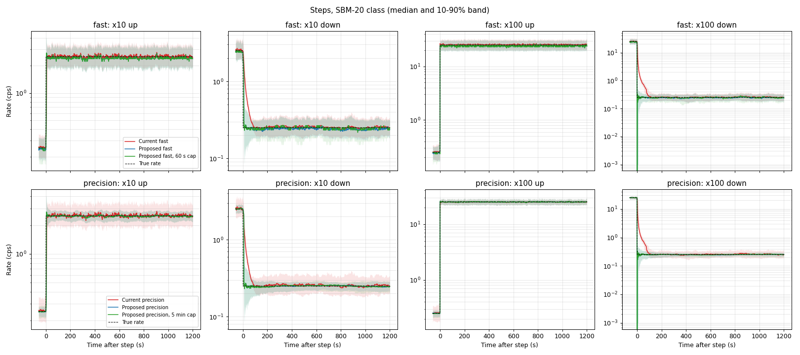
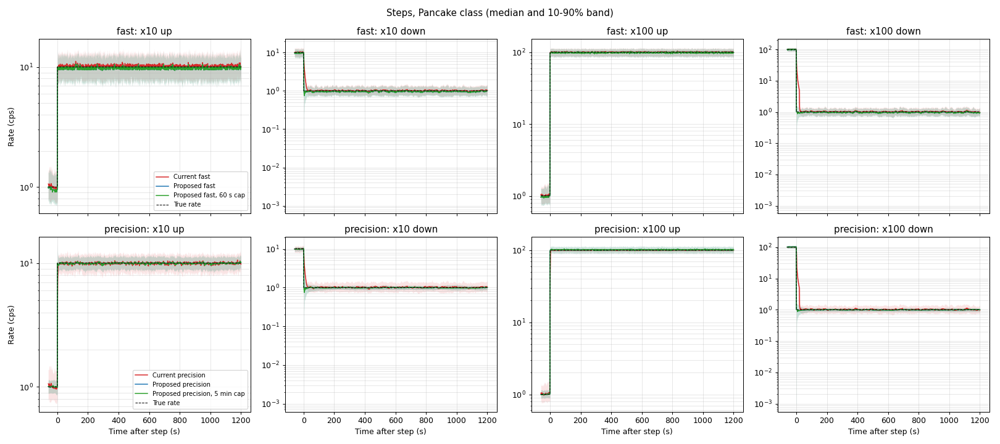
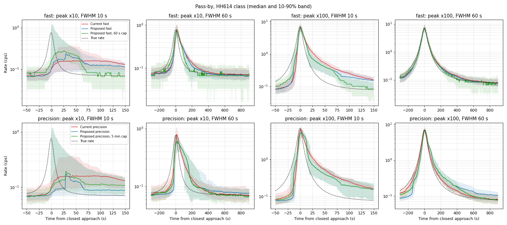
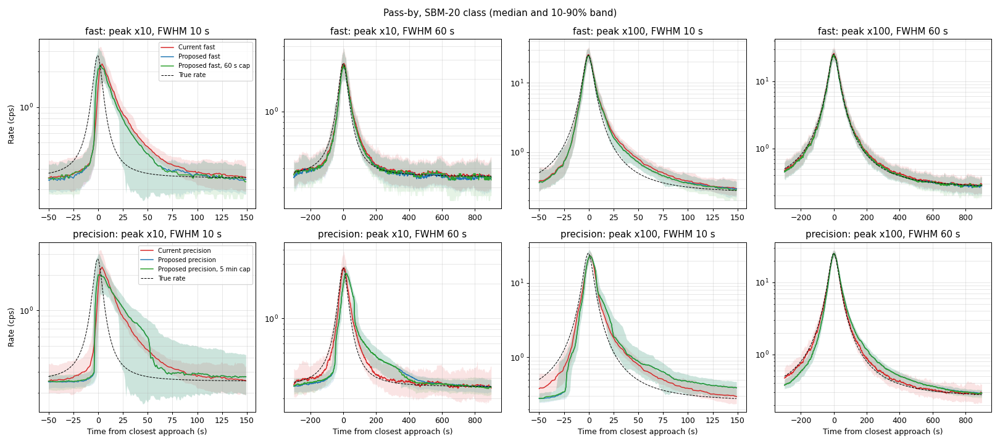
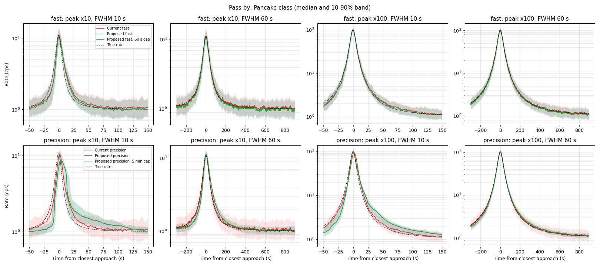

# Instantaneous rate simulation

Generated by `simulate.py`. Pulse targets: fast 20, precision 100. Caps (variants): fast 60 s, precision 300 s. Proposed buffer: 64 x 1 s + 64 x 16 s.

## 1. Change detection threshold

False restarts per hour at constant rates (160 h simulated per rate). Target: at most 0.1/h at every rate. **Chosen threshold: G > 22.**

| Rate (cps) | G > 10 | G > 12 | G > 14 | G > 16 | G > 18 | G > 20 | G > 22 | G > 25 | G > 30 |
|---|---|---|---|---|---|---|---|---|---|
| 0.07 | 5.20 | 2.23 | 0.72 | 0.34 | 0.09 | 0.03 | 0.01 | 0.00 | 0.00 |
| 0.25 | 7.19 | 2.84 | 1.48 | 0.43 | 0.19 | 0.07 | 0.01 | 0.01 | 0.00 |
| 1 | 14.04 | 4.71 | 2.24 | 0.95 | 0.21 | 0.13 | 0.03 | 0.01 | 0.00 |
| 10 | 18.17 | 8.13 | 2.56 | 1.20 | 0.52 | 0.17 | 0.04 | 0.00 | 0.00 |
| 100 | 19.29 | 6.91 | 2.49 | 0.91 | 0.31 | 0.11 | 0.04 | 0.00 | 0.00 |
| 1000 | 20.38 | 7.79 | 2.81 | 1.13 | 0.41 | 0.11 | 0.06 | 0.03 | 0.00 |

## 2. Steady state

Coverage: fraction of seconds where the true rate lies within the displayed value +/- confidence interval (should be ~95%).

### Estimator when the pulse target is met (n / W vs (n - 1) / W)

| Algorithm | Rate (cps) | Bias | Std dev | 99th pct error | 95% coverage | Median window | Restarts/h |
|---|---|---|---|---|---|---|---|
| Proposed fast, n | 0.07 | +5.6% | 24.3% | 75% | 97.1% | 287 s | 0.00 |
| Proposed fast, n | 0.25 | +5.4% | 24.8% | 82% | 96.9% | 87 s | 0.00 |
| Proposed fast, n | 1 | +5.4% | 24.3% | 82% | 97.0% | 20 s | 0.02 |
| Proposed fast, n | 10 | +3.4% | 20.7% | 55% | 96.3% | 2 s | 0.00 |
| Proposed fast, n | 100 | -0.0% | 10.0% | 26% | 95.7% | 1 s | 0.07 |
| Proposed fast, n-1 | 0.07 | +0.5% | 23.1% | 67% | 95.7% | 287 s | 0.00 |
| Proposed fast, n-1 | 0.25 | +0.5% | 23.6% | 73% | 95.6% | 87 s | 0.00 |
| Proposed fast, n-1 | 1 | +0.3% | 23.2% | 73% | 96.0% | 20 s | 0.02 |
| Proposed fast, n-1 | 10 | -0.8% | 20.0% | 53% | 94.6% | 2 s | 0.00 |
| Proposed fast, n-1 | 100 | -1.0% | 10.0% | 26% | 95.2% | 1 s | 0.07 |
| Proposed precision, n | 0.07 | +0.8% | 11.8% | 28% | 96.2% | 1016 s | 0.00 |
| Proposed precision, n | 0.25 | +1.0% | 10.4% | 29% | 95.4% | 407 s | 0.00 |
| Proposed precision, n | 1 | +1.2% | 9.8% | 27% | 96.3% | 107 s | 0.02 |
| Proposed precision, n | 10 | +0.9% | 10.0% | 27% | 96.2% | 10 s | 0.00 |
| Proposed precision, n | 100 | +2.0% | 8.5% | 24% | 95.8% | 1 s | 0.07 |
| Proposed precision, n-1 | 0.07 | +0.8% | 11.8% | 28% | 96.2% | 1016 s | 0.00 |
| Proposed precision, n-1 | 0.25 | -0.0% | 10.3% | 28% | 95.0% | 407 s | 0.00 |
| Proposed precision, n-1 | 1 | +0.3% | 9.7% | 26% | 96.1% | 107 s | 0.02 |
| Proposed precision, n-1 | 10 | -0.0% | 9.9% | 26% | 95.8% | 10 s | 0.00 |
| Proposed precision, n-1 | 100 | +1.2% | 8.3% | 23% | 95.5% | 1 s | 0.07 |

Largest absolute bias: n / W 5.6%, (n - 1) / W 1.2%. **Chosen estimator: (n - 1) / W.**

### All algorithms

| Algorithm | Rate (cps) | Bias | Std dev | 99th pct error | 95% coverage | Median window | Restarts/h |
|---|---|---|---|---|---|---|---|
| Current 60 s | 0.07 | +53.5% | 222.9% | 572% | 91.6% | 36 s | 0.00 |
| Current 60 s | 0.25 | +6.9% | 27.9% | 78% | 97.4% | 54 s | 0.00 |
| Current 60 s | 1 | +1.4% | 13.0% | 34% | 96.5% | 59 s | 0.00 |
| Current 60 s | 10 | +0.0% | 4.1% | 10% | 95.5% | 60 s | 0.00 |
| Current 60 s | 100 | -0.0% | 1.3% | 3% | 95.5% | 60 s | 0.00 |
| Proposed 60 s | 0.07 | +0.4% | 49.1% | 138% | 91.8% | 60 s | 0.00 |
| Proposed 60 s | 0.25 | +0.0% | 26.0% | 67% | 95.5% | 60 s | 0.00 |
| Proposed 60 s | 1 | +0.4% | 12.9% | 33% | 96.6% | 60 s | 0.00 |
| Proposed 60 s | 10 | +0.0% | 4.1% | 10% | 95.6% | 60 s | 0.00 |
| Proposed 60 s | 100 | -0.0% | 1.3% | 3% | 95.5% | 60 s | 0.00 |
| Current fast | 0.07 | +6.1% | 25.4% | 83% | 97.0% | 264 s | 0.00 |
| Current fast | 0.25 | +5.6% | 25.7% | 84% | 97.0% | 75 s | 0.00 |
| Current fast | 1 | +5.4% | 24.9% | 79% | 97.2% | 19 s | 0.00 |
| Current fast | 10 | +3.2% | 21.2% | 60% | 96.5% | 2 s | 0.00 |
| Current fast | 100 | +0.0% | 10.1% | 26% | 95.8% | 1 s | 0.00 |
| Current precision | 0.07 | +6.1% | 25.4% | 83% | 97.0% | 264 s | 0.00 |
| Current precision | 0.25 | +5.6% | 25.7% | 84% | 97.0% | 75 s | 0.00 |
| Current precision | 1 | +5.4% | 24.9% | 79% | 97.2% | 19 s | 0.00 |
| Current precision | 10 | +0.0% | 14.3% | 37% | 95.8% | 5 s | 0.00 |
| Current precision | 100 | -0.0% | 4.5% | 11% | 95.5% | 5 s | 0.00 |
| Proposed fast | 0.07 | +0.5% | 23.1% | 67% | 95.7% | 287 s | 0.00 |
| Proposed fast | 0.25 | +0.5% | 23.6% | 73% | 95.6% | 87 s | 0.00 |
| Proposed fast | 1 | +0.3% | 23.2% | 73% | 96.0% | 20 s | 0.02 |
| Proposed fast | 10 | -0.8% | 20.0% | 53% | 94.6% | 2 s | 0.00 |
| Proposed fast | 100 | -1.0% | 10.0% | 26% | 95.2% | 1 s | 0.07 |
| Proposed precision | 0.07 | +0.8% | 11.8% | 28% | 96.2% | 1016 s | 0.00 |
| Proposed precision | 0.25 | -0.0% | 10.3% | 28% | 95.0% | 407 s | 0.00 |
| Proposed precision | 1 | +0.3% | 9.7% | 26% | 96.1% | 107 s | 0.02 |
| Proposed precision | 10 | -0.0% | 9.9% | 26% | 95.8% | 10 s | 0.00 |
| Proposed precision | 100 | +1.2% | 8.3% | 23% | 95.5% | 1 s | 0.07 |
| Proposed fast, 60 s cap | 0.07 | +0.4% | 49.1% | 138% | 91.8% | 60 s | 0.00 |
| Proposed fast, 60 s cap | 0.25 | -0.0% | 26.3% | 73% | 96.0% | 60 s | 0.00 |
| Proposed fast, 60 s cap | 1 | +0.3% | 23.2% | 73% | 96.0% | 20 s | 0.02 |
| Proposed fast, 60 s cap | 10 | -0.8% | 20.0% | 53% | 94.6% | 2 s | 0.00 |
| Proposed fast, 60 s cap | 100 | -1.0% | 10.0% | 26% | 95.2% | 1 s | 0.07 |
| Proposed precision, 5 min cap | 0.07 | +0.6% | 22.4% | 56% | 95.8% | 292 s | 0.00 |
| Proposed precision, 5 min cap | 0.25 | -0.0% | 12.0% | 32% | 95.7% | 292 s | 0.00 |
| Proposed precision, 5 min cap | 1 | +0.3% | 9.7% | 26% | 96.1% | 107 s | 0.02 |
| Proposed precision, 5 min cap | 10 | -0.0% | 9.9% | 26% | 95.8% | 10 s | 0.00 |
| Proposed precision, 5 min cap | 100 | +1.2% | 8.3% | 23% | 95.5% | 1 s | 0.07 |

## 3. Steps

Mean reading (over trials) divided by the new true rate, at several delays after the step. Settle: first delay after which the mean stays within +/-20% of the new rate. Plots show the median and the 10-90% band.

### HH614 class (background 0.07 cps)

| Step | Algorithm | 1 s | 3 s | 10 s | 30 s | 100 s | 300 s | 1000 s | Settle |
|---|---|---|---|---|---|---|---|---|---|
| x2 up | Current fast | 0.50 | 0.50 | 0.51 | 0.56 | 0.81 | 1.08 | 1.07 | 96 s |
| x2 up | Current precision | 0.50 | 0.50 | 0.51 | 0.56 | 0.81 | 1.08 | 1.07 | 96 s |
| x2 up | Proposed fast | 0.47 | 0.48 | 0.49 | 0.54 | 0.77 | 1.01 | 1.02 | 107 s |
| x2 up | Proposed precision | 0.49 | 0.49 | 0.50 | 0.51 | 0.58 | 0.78 | 1.00 | 336 s |
| x2 up | Proposed fast, 60 s cap | 0.49 | 0.51 | 0.57 | 0.74 | 0.97 | 1.01 | 1.01 | 33 s |
| x2 up | Proposed precision, 5 min cap | 0.49 | 0.49 | 0.50 | 0.53 | 0.68 | 1.02 | 1.00 | 161 s |
| x2 down | Current fast | 2.08 | 2.08 | 2.06 | 1.97 | 1.56 | 1.02 | 1.01 | 191 s |
| x2 down | Current precision | 2.08 | 2.08 | 2.06 | 1.97 | 1.56 | 1.02 | 1.01 | 191 s |
| x2 down | Proposed fast | 1.94 | 1.94 | 1.89 | 1.74 | 1.42 | 0.97 | 0.95 | 171 s |
| x2 down | Proposed precision | 1.98 | 1.98 | 1.97 | 1.94 | 1.85 | 1.51 | 0.98 | 729 s |
| x2 down | Proposed fast, 60 s cap | 1.89 | 1.87 | 1.76 | 1.42 | 0.94 | 1.01 | 0.95 | 42 s |
| x2 down | Proposed precision, 5 min cap | 2.00 | 2.00 | 1.97 | 1.88 | 1.61 | 0.94 | 0.96 | 209 s |
| x10 up | Current fast | 0.11 | 0.11 | 0.16 | 0.86 | 1.07 | 1.02 | 1.02 | 29 s |
| x10 up | Current precision | 0.11 | 0.11 | 0.16 | 0.86 | 1.07 | 1.02 | 1.02 | 29 s |
| x10 up | Proposed fast | 0.10 | 0.36 | 0.75 | 1.00 | 1.02 | 0.97 | 0.96 | 13 s |
| x10 up | Proposed precision | 0.10 | 0.35 | 0.74 | 1.00 | 0.98 | 1.00 | 0.98 | 13 s |
| x10 up | Proposed fast, 60 s cap | 0.12 | 0.39 | 0.79 | 1.00 | 1.02 | 0.97 | 0.96 | 12 s |
| x10 up | Proposed precision, 5 min cap | 0.10 | 0.36 | 0.75 | 1.00 | 0.98 | 1.00 | 0.98 | 13 s |
| x10 down | Current fast | 10.57 | 10.51 | 9.72 | 6.84 | 2.73 | 1.11 | 1.05 | 255 s |
| x10 down | Current precision | 10.57 | 10.51 | 9.72 | 6.84 | 2.73 | 1.11 | 1.05 | 255 s |
| x10 down | Proposed fast | 9.66 | 9.06 | 7.47 | 2.14 | 0.99 | 1.00 | 0.99 | 32 s |
| x10 down | Proposed precision | 9.84 | 9.72 | 9.33 | 2.91 | 0.99 | 1.00 | 1.01 | 49 s |
| x10 down | Proposed fast, 60 s cap | 9.66 | 9.06 | 7.47 | 2.13 | 1.04 | 1.01 | 1.00 | 32 s |
| x10 down | Proposed precision, 5 min cap | 9.84 | 9.72 | 9.33 | 2.91 | 0.99 | 1.00 | 0.99 | 49 s |
| x100 up | Current fast | 0.02 | 0.68 | 1.08 | 1.03 | 1.01 | 1.06 | 1.03 | 4 s |
| x100 up | Current precision | 0.02 | 0.66 | 1.03 | 1.00 | 0.99 | 1.01 | 0.99 | 4 s |
| x100 up | Proposed fast | 0.97 | 0.95 | 1.04 | 0.99 | 0.97 | 1.02 | 0.98 | 1 s |
| x100 up | Proposed precision | 0.97 | 0.97 | 1.00 | 1.00 | 0.99 | 1.01 | 0.99 | 1 s |
| x100 up | Proposed fast, 60 s cap | 0.97 | 0.95 | 1.04 | 0.99 | 0.97 | 1.02 | 0.98 | 1 s |
| x100 up | Proposed precision, 5 min cap | 0.97 | 0.97 | 1.00 | 1.00 | 0.99 | 1.01 | 0.99 | 1 s |
| x100 down | Current fast | 102.37 | 96.82 | 72.98 | 25.61 | 3.65 | 1.21 | 1.05 | 307 s |
| x100 down | Current precision | 99.66 | 96.82 | 72.98 | 25.61 | 3.65 | 1.21 | 1.05 | 307 s |
| x100 down | Proposed fast | 74.89 | 2.85 | 1.09 | 1.05 | 1.00 | 1.02 | 1.00 | 5 s |
| x100 down | Proposed precision | 94.72 | 3.64 | 1.09 | 1.05 | 1.00 | 1.02 | 1.01 | 5 s |
| x100 down | Proposed fast, 60 s cap | 74.89 | 2.85 | 1.09 | 1.05 | 1.01 | 1.06 | 1.03 | 5 s |
| x100 down | Proposed precision, 5 min cap | 94.72 | 3.64 | 1.09 | 1.05 | 1.00 | 1.02 | 0.99 | 5 s |

### SBM-20 class (background 0.25 cps)

| Step | Algorithm | 1 s | 3 s | 10 s | 30 s | 100 s | 300 s | 1000 s | Settle |
|---|---|---|---|---|---|---|---|---|---|
| x2 up | Current fast | 0.55 | 0.55 | 0.61 | 0.92 | 1.05 | 1.03 | 1.06 | 23 s |
| x2 up | Current precision | 0.55 | 0.55 | 0.61 | 0.92 | 1.05 | 1.03 | 1.06 | 23 s |
| x2 up | Proposed fast | 0.52 | 0.53 | 0.60 | 0.88 | 0.99 | 0.98 | 1.01 | 24 s |
| x2 up | Proposed precision | 0.51 | 0.51 | 0.52 | 0.59 | 0.83 | 0.99 | 0.98 | 71 s |
| x2 up | Proposed fast, 60 s cap | 0.53 | 0.54 | 0.61 | 0.88 | 0.99 | 0.98 | 1.01 | 24 s |
| x2 up | Proposed precision, 5 min cap | 0.51 | 0.51 | 0.52 | 0.59 | 0.84 | 0.99 | 0.98 | 66 s |
| x2 down | Current fast | 2.06 | 2.03 | 1.93 | 1.58 | 1.09 | 1.08 | 1.08 | 66 s |
| x2 down | Current precision | 2.06 | 2.03 | 1.93 | 1.58 | 1.09 | 1.08 | 1.08 | 66 s |
| x2 down | Proposed fast | 1.93 | 1.89 | 1.78 | 1.48 | 1.03 | 1.03 | 1.03 | 61 s |
| x2 down | Proposed precision | 2.00 | 2.00 | 1.96 | 1.88 | 1.51 | 1.02 | 1.00 | 167 s |
| x2 down | Proposed fast, 60 s cap | 1.93 | 1.89 | 1.78 | 1.47 | 1.02 | 1.03 | 1.03 | 51 s |
| x2 down | Proposed precision, 5 min cap | 2.00 | 2.00 | 1.96 | 1.88 | 1.51 | 1.00 | 1.00 | 163 s |
| x10 up | Current fast | 0.12 | 0.18 | 1.02 | 1.04 | 1.07 | 0.98 | 1.05 | 8 s |
| x10 up | Current precision | 0.12 | 0.18 | 1.02 | 1.04 | 1.06 | 0.98 | 1.05 | 8 s |
| x10 up | Proposed fast | 0.18 | 0.73 | 1.01 | 1.00 | 1.02 | 0.94 | 1.01 | 4 s |
| x10 up | Proposed precision | 0.16 | 0.71 | 1.02 | 1.00 | 1.01 | 0.99 | 1.02 | 4 s |
| x10 up | Proposed fast, 60 s cap | 0.18 | 0.73 | 1.01 | 1.00 | 1.02 | 0.94 | 1.01 | 4 s |
| x10 up | Proposed precision, 5 min cap | 0.17 | 0.72 | 1.02 | 1.00 | 1.01 | 0.99 | 1.02 | 4 s |
| x10 down | Current fast | 10.30 | 9.59 | 6.13 | 2.60 | 1.02 | 1.09 | 1.02 | 72 s |
| x10 down | Current precision | 10.30 | 9.59 | 6.13 | 2.60 | 1.02 | 1.09 | 1.02 | 72 s |
| x10 down | Proposed fast | 9.02 | 7.46 | 1.33 | 1.06 | 0.97 | 1.03 | 0.96 | 13 s |
| x10 down | Proposed precision | 9.85 | 9.42 | 1.60 | 1.06 | 0.97 | 0.99 | 0.99 | 14 s |
| x10 down | Proposed fast, 60 s cap | 9.02 | 7.46 | 1.33 | 1.06 | 0.97 | 1.02 | 0.98 | 13 s |
| x10 down | Proposed precision, 5 min cap | 9.85 | 9.42 | 1.60 | 1.06 | 0.97 | 0.99 | 0.99 | 14 s |
| x100 up | Current fast | 0.99 | 1.04 | 1.04 | 1.04 | 0.99 | 1.04 | 1.03 | 1 s |
| x100 up | Current precision | 0.61 | 0.93 | 0.99 | 1.01 | 0.99 | 1.01 | 1.00 | 2 s |
| x100 up | Proposed fast | 0.99 | 1.00 | 1.00 | 1.00 | 0.96 | 1.00 | 0.99 | 1 s |
| x100 up | Proposed precision | 1.03 | 1.02 | 1.00 | 1.01 | 0.99 | 1.01 | 0.99 | 1 s |
| x100 up | Proposed fast, 60 s cap | 0.99 | 1.00 | 1.00 | 1.00 | 0.96 | 1.00 | 0.99 | 1 s |
| x100 up | Proposed precision, 5 min cap | 1.03 | 1.02 | 1.00 | 1.01 | 0.99 | 1.01 | 0.99 | 1 s |
| x100 down | Current fast | 88.74 | 64.71 | 23.43 | 4.68 | 1.14 | 1.02 | 1.07 | 96 s |
| x100 down | Current precision | 94.14 | 70.97 | 23.43 | 4.68 | 1.14 | 1.02 | 1.07 | 96 s |
| x100 down | Proposed fast | 0.96 | 0.95 | 1.02 | 1.01 | 1.00 | 0.97 | 1.02 | 1 s |
| x100 down | Proposed precision | 0.96 | 0.95 | 1.02 | 1.01 | 1.01 | 1.00 | 1.01 | 1 s |
| x100 down | Proposed fast, 60 s cap | 0.96 | 0.95 | 1.02 | 1.01 | 0.99 | 0.98 | 1.00 | 1 s |
| x100 down | Proposed precision, 5 min cap | 0.96 | 0.95 | 1.02 | 1.01 | 1.01 | 1.00 | 1.02 | 1 s |

### Pancake class (background 1.0 cps)

| Step | Algorithm | 1 s | 3 s | 10 s | 30 s | 100 s | 300 s | 1000 s | Settle |
|---|---|---|---|---|---|---|---|---|---|
| x2 up | Current fast | 0.55 | 0.62 | 0.98 | 1.05 | 1.09 | 1.09 | 1.07 | 7 s |
| x2 up | Current precision | 0.55 | 0.62 | 0.98 | 1.05 | 1.09 | 1.09 | 1.07 | 7 s |
| x2 up | Proposed fast | 0.57 | 0.61 | 0.94 | 1.01 | 1.04 | 1.03 | 1.03 | 7 s |
| x2 up | Proposed precision | 0.54 | 0.52 | 0.62 | 0.91 | 1.01 | 1.01 | 1.01 | 24 s |
| x2 up | Proposed fast, 60 s cap | 0.57 | 0.61 | 0.94 | 1.01 | 1.04 | 1.03 | 1.03 | 7 s |
| x2 up | Proposed precision, 5 min cap | 0.54 | 0.52 | 0.62 | 0.91 | 1.01 | 1.01 | 1.01 | 24 s |
| x2 down | Current fast | 2.04 | 1.82 | 1.39 | 1.05 | 1.04 | 1.05 | 1.03 | 15 s |
| x2 down | Current precision | 2.04 | 1.82 | 1.39 | 1.05 | 1.04 | 1.05 | 1.03 | 15 s |
| x2 down | Proposed fast | 1.88 | 1.70 | 1.30 | 1.01 | 0.99 | 1.01 | 0.98 | 13 s |
| x2 down | Proposed precision | 2.00 | 1.96 | 1.82 | 1.35 | 1.01 | 0.99 | 1.00 | 40 s |
| x2 down | Proposed fast, 60 s cap | 1.88 | 1.70 | 1.30 | 1.01 | 0.99 | 1.01 | 0.98 | 13 s |
| x2 down | Proposed precision, 5 min cap | 2.00 | 1.96 | 1.82 | 1.35 | 1.01 | 0.99 | 1.00 | 40 s |
| x10 up | Current fast | 0.20 | 1.01 | 1.05 | 1.06 | 0.98 | 1.06 | 1.04 | 3 s |
| x10 up | Current precision | 0.20 | 0.76 | 0.98 | 1.00 | 0.98 | 1.00 | 1.00 | 4 s |
| x10 up | Proposed fast | 0.81 | 0.98 | 1.01 | 1.02 | 0.95 | 1.02 | 1.00 | 1 s |
| x10 up | Proposed precision | 0.79 | 0.97 | 0.98 | 1.00 | 0.98 | 0.98 | 0.98 | 2 s |
| x10 up | Proposed fast, 60 s cap | 0.81 | 0.98 | 1.01 | 1.02 | 0.95 | 1.02 | 1.00 | 1 s |
| x10 up | Proposed precision, 5 min cap | 0.79 | 0.97 | 0.98 | 1.00 | 0.98 | 0.98 | 0.98 | 2 s |
| x10 down | Current fast | 8.40 | 5.44 | 2.24 | 1.06 | 1.04 | 1.06 | 1.04 | 21 s |
| x10 down | Current precision | 8.82 | 5.50 | 2.24 | 1.06 | 1.04 | 1.06 | 1.04 | 21 s |
| x10 down | Proposed fast | 7.00 | 1.15 | 0.97 | 1.01 | 0.99 | 1.00 | 1.00 | 3 s |
| x10 down | Proposed precision | 9.14 | 1.25 | 0.98 | 0.99 | 0.99 | 1.00 | 1.00 | 4 s |
| x10 down | Proposed fast, 60 s cap | 7.00 | 1.15 | 0.97 | 1.01 | 0.99 | 1.00 | 1.00 | 3 s |
| x10 down | Proposed precision, 5 min cap | 9.14 | 1.25 | 0.98 | 0.99 | 0.99 | 1.00 | 1.00 | 4 s |
| x100 up | Current fast | 0.98 | 1.00 | 1.00 | 0.99 | 0.98 | 1.00 | 1.01 | 1 s |
| x100 up | Current precision | 0.30 | 0.76 | 1.01 | 1.00 | 1.00 | 1.00 | 1.00 | 4 s |
| x100 up | Proposed fast | 0.97 | 0.99 | 0.99 | 0.98 | 0.97 | 0.98 | 1.00 | 1 s |
| x100 up | Proposed precision | 0.98 | 1.02 | 1.01 | 1.01 | 1.00 | 1.00 | 1.02 | 1 s |
| x100 up | Proposed fast, 60 s cap | 0.97 | 0.99 | 0.99 | 0.98 | 0.97 | 0.98 | 1.00 | 1 s |
| x100 up | Proposed precision, 5 min cap | 0.98 | 1.02 | 1.01 | 1.01 | 1.00 | 1.00 | 1.02 | 1 s |
| x100 down | Current fast | 65.34 | 34.36 | 10.35 | 1.16 | 1.10 | 1.02 | 1.01 | 30 s |
| x100 down | Current precision | 86.49 | 48.94 | 10.35 | 1.16 | 1.10 | 1.02 | 1.01 | 30 s |
| x100 down | Proposed fast | 1.00 | 1.00 | 1.00 | 0.99 | 1.04 | 0.98 | 0.97 | 1 s |
| x100 down | Proposed precision | 1.00 | 1.00 | 1.00 | 0.99 | 1.00 | 1.00 | 1.00 | 1 s |
| x100 down | Proposed fast, 60 s cap | 1.00 | 1.00 | 1.00 | 0.99 | 1.04 | 0.98 | 0.97 | 1 s |
| x100 down | Proposed precision, 5 min cap | 1.00 | 1.00 | 1.00 | 0.99 | 1.00 | 1.00 | 1.00 | 1 s |

## 4. Walking past a source

Rate = background x (1 + peak / (1 + ((t - tc) / (FWHM / 2))^2)). From the mean trajectory: peak reading / true peak, delay of the reading peak, and mean reading / true rate over the retreat (tc + FWHM to tc + 10 FWHM).

| Tube | Peak | FWHM | Algorithm | Peak ratio | Peak delay | Retreat ratio |
|---|---|---|---|---|---|---|
| HH614 class | x10 | 10 s | Current fast | 0.26 | +38 s | 2.18 |
| HH614 class | x10 | 10 s | Current precision | 0.26 | +38 s | 2.18 |
| HH614 class | x10 | 10 s | Proposed fast | 0.54 | +6 s | 2.28 |
| HH614 class | x10 | 10 s | Proposed precision | 0.51 | +6 s | 2.07 |
| HH614 class | x10 | 10 s | Proposed fast, 60 s cap | 0.58 | +6 s | 2.17 |
| HH614 class | x10 | 10 s | Proposed precision, 5 min cap | 0.53 | +6 s | 2.18 |
| HH614 class | x10 | 60 s | Current fast | 1.05 | +15 s | 1.40 |
| HH614 class | x10 | 60 s | Current precision | 1.05 | +15 s | 1.40 |
| HH614 class | x10 | 60 s | Proposed fast | 0.99 | +16 s | 1.24 |
| HH614 class | x10 | 60 s | Proposed precision | 0.77 | +18 s | 1.55 |
| HH614 class | x10 | 60 s | Proposed fast, 60 s cap | 0.99 | +16 s | 1.11 |
| HH614 class | x10 | 60 s | Proposed precision, 5 min cap | 0.77 | +18 s | 1.48 |
| HH614 class | x100 | 10 s | Current fast | 0.97 | +1 s | 3.43 |
| HH614 class | x100 | 10 s | Current precision | 0.91 | +1 s | 3.43 |
| HH614 class | x100 | 10 s | Proposed fast | 0.93 | +1 s | 2.39 |
| HH614 class | x100 | 10 s | Proposed precision | 0.75 | +2 s | 2.62 |
| HH614 class | x100 | 10 s | Proposed fast, 60 s cap | 0.93 | +1 s | 2.18 |
| HH614 class | x100 | 10 s | Proposed precision, 5 min cap | 0.75 | +2 s | 2.62 |
| HH614 class | x100 | 60 s | Current fast | 1.06 | +4 s | 1.29 |
| HH614 class | x100 | 60 s | Current precision | 1.01 | +4 s | 1.29 |
| HH614 class | x100 | 60 s | Proposed fast | 1.02 | +4 s | 1.21 |
| HH614 class | x100 | 60 s | Proposed precision | 0.99 | +8 s | 1.72 |
| HH614 class | x100 | 60 s | Proposed fast, 60 s cap | 1.02 | +4 s | 1.11 |
| HH614 class | x100 | 60 s | Proposed precision, 5 min cap | 0.99 | +8 s | 1.61 |
| SBM-20 class | x10 | 10 s | Current fast | 0.84 | +5 s | 1.83 |
| SBM-20 class | x10 | 10 s | Current precision | 0.84 | +5 s | 1.83 |
| SBM-20 class | x10 | 10 s | Proposed fast | 0.84 | +3 s | 1.46 |
| SBM-20 class | x10 | 10 s | Proposed precision | 0.76 | +3 s | 1.87 |
| SBM-20 class | x10 | 10 s | Proposed fast, 60 s cap | 0.84 | +3 s | 1.45 |
| SBM-20 class | x10 | 10 s | Proposed precision, 5 min cap | 0.76 | +3 s | 1.87 |
| SBM-20 class | x10 | 60 s | Current fast | 1.04 | +4 s | 1.12 |
| SBM-20 class | x10 | 60 s | Current precision | 1.04 | +4 s | 1.12 |
| SBM-20 class | x10 | 60 s | Proposed fast | 1.00 | +4 s | 1.06 |
| SBM-20 class | x10 | 60 s | Proposed precision | 0.90 | +16 s | 1.31 |
| SBM-20 class | x10 | 60 s | Proposed fast, 60 s cap | 1.00 | +4 s | 1.05 |
| SBM-20 class | x10 | 60 s | Proposed precision, 5 min cap | 0.90 | +16 s | 1.29 |
| SBM-20 class | x100 | 10 s | Current fast | 1.03 | +1 s | 1.51 |
| SBM-20 class | x100 | 10 s | Current precision | 0.93 | +2 s | 1.51 |
| SBM-20 class | x100 | 10 s | Proposed fast | 1.00 | +1 s | 1.35 |
| SBM-20 class | x100 | 10 s | Proposed precision | 0.95 | +2 s | 1.79 |
| SBM-20 class | x100 | 10 s | Proposed fast, 60 s cap | 1.00 | +1 s | 1.35 |
| SBM-20 class | x100 | 10 s | Proposed precision, 5 min cap | 0.95 | +2 s | 1.79 |
| SBM-20 class | x100 | 60 s | Current fast | 1.03 | +0 s | 1.11 |
| SBM-20 class | x100 | 60 s | Current precision | 1.00 | +4 s | 1.11 |
| SBM-20 class | x100 | 60 s | Proposed fast | 0.99 | +0 s | 1.06 |
| SBM-20 class | x100 | 60 s | Proposed precision | 1.00 | +3 s | 1.28 |
| SBM-20 class | x100 | 60 s | Proposed fast, 60 s cap | 0.99 | +0 s | 1.05 |
| SBM-20 class | x100 | 60 s | Proposed precision, 5 min cap | 1.00 | +3 s | 1.28 |
| Pancake class | x10 | 10 s | Current fast | 1.03 | +1 s | 1.16 |
| Pancake class | x10 | 10 s | Current precision | 0.93 | +2 s | 1.16 |
| Pancake class | x10 | 10 s | Proposed fast | 0.99 | +1 s | 1.09 |
| Pancake class | x10 | 10 s | Proposed precision | 0.80 | +4 s | 1.39 |
| Pancake class | x10 | 10 s | Proposed fast, 60 s cap | 0.99 | +1 s | 1.09 |
| Pancake class | x10 | 10 s | Proposed precision, 5 min cap | 0.80 | +4 s | 1.39 |
| Pancake class | x10 | 60 s | Current fast | 1.04 | -1 s | 1.06 |
| Pancake class | x10 | 60 s | Current precision | 1.00 | +0 s | 1.06 |
| Pancake class | x10 | 60 s | Proposed fast | 1.01 | -1 s | 1.01 |
| Pancake class | x10 | 60 s | Proposed precision | 1.00 | +6 s | 1.07 |
| Pancake class | x10 | 60 s | Proposed fast, 60 s cap | 1.01 | -1 s | 1.01 |
| Pancake class | x10 | 60 s | Proposed precision, 5 min cap | 1.00 | +6 s | 1.07 |
| Pancake class | x100 | 10 s | Current fast | 0.99 | +0 s | 1.14 |
| Pancake class | x100 | 10 s | Current precision | 0.93 | +2 s | 1.16 |
| Pancake class | x100 | 10 s | Proposed fast | 0.98 | +0 s | 1.08 |
| Pancake class | x100 | 10 s | Proposed precision | 1.00 | +1 s | 1.39 |
| Pancake class | x100 | 10 s | Proposed fast, 60 s cap | 0.98 | +0 s | 1.08 |
| Pancake class | x100 | 10 s | Proposed precision, 5 min cap | 1.00 | +1 s | 1.39 |
| Pancake class | x100 | 60 s | Current fast | 1.01 | +0 s | 1.06 |
| Pancake class | x100 | 60 s | Current precision | 1.00 | +3 s | 1.06 |
| Pancake class | x100 | 60 s | Proposed fast | 1.00 | +3 s | 1.01 |
| Pancake class | x100 | 60 s | Proposed precision | 1.02 | +3 s | 1.07 |
| Pancake class | x100 | 60 s | Proposed fast, 60 s cap | 1.00 | +3 s | 1.01 |
| Pancake class | x100 | 60 s | Proposed precision, 5 min cap | 1.02 | +3 s | 1.07 |

## 5. Dead time

Non-paralyzable dead time 150 us, measured pulses simulated as a renewal process, compensation with the same dead time. Confidence from raw counts, not widened by the compensation factor.

| Algorithm | True rate (cps) | Measured (cps) | Bias | Std dev | 95% coverage | Restarts/h |
|---|---|---|---|---|---|---|
| Current fast | 1000 | 870 | +0.0% | 3.4% | 95.6% | 0.00 |
| Current fast | 5000 | 2857 | -0.0% | 1.9% | 95.3% | 0.00 |
| Current fast | 20000 | 5000 | -0.0% | 1.4% | 94.8% | 0.00 |
| Proposed fast | 1000 | 870 | -0.2% | 3.4% | 95.7% | 0.00 |
| Proposed fast | 5000 | 2857 | -0.1% | 1.9% | 95.4% | 0.00 |
| Proposed fast | 20000 | 5000 | -0.1% | 1.4% | 94.6% | 0.00 |
| Proposed precision | 1000 | 870 | -0.2% | 3.4% | 95.7% | 0.00 |
| Proposed precision | 5000 | 2857 | -0.1% | 1.9% | 95.4% | 0.00 |
| Proposed precision | 20000 | 5000 | -0.1% | 1.4% | 94.6% | 0.00 |
| Proposed 60 s | 1000 | 870 | -0.0% | 0.5% | 94.8% | 0.00 |
| Proposed 60 s | 5000 | 2857 | -0.0% | 0.3% | 94.8% | 0.00 |
| Proposed 60 s | 20000 | 5000 | -0.0% | 0.2% | 94.8% | 0.00 |

### Dose over a 60 s exposure at 5000 cps

300 s background (0.25 cps), 60 s at 5000 cps true, 300 s background. Dose error vs the true number of pulses.

| Compensation | Mean dose error | Std dev |
|---|---|---|
| None (raw counts) | -42.8% | 0.1% |
| Current, factor from instantaneous (adaptive fast) | +0.0% | 0.2% |
| Current, factor from instantaneous (adaptive precision) | -0.6% | 0.6% |
| Current, factor from instantaneous (60 s) | -23.2% | 0.9% |
| Proposed, factor from each second's count | +0.0% | 0.2% |

## 6. Alerts

The true rate jumps from 0.2x the alert threshold to the ratio shown and stays there for 10800 s. Alert starts per hour and time in alert are measured after the first 600 s; delay is the median time to the first alert after the jump.

Policies (c = 95% confidence half-width, c/2 = about 1σ):

- **none**: current firmware, alert while reading >= threshold.
- **hysteresis**: raise at reading >= threshold; clear when reading x (1 + c) < threshold.
- **hysteresis 1σ**: as hysteresis, clear when reading x (1 + c/2) < threshold.
- **strict**: raise when reading x (1 - c) >= threshold; clear when reading x (1 + c) < threshold.
- **strict 1σ**: as strict, with c/2.

Adaptive modes only raise when the confidence interval is below +/-75% (firmware gate).

### Threshold 0.3 cps

**Alert starts per hour** (true rate / threshold):

| Mode | Algorithm | Policy | 0.5x | 0.8x | 0.9x | 1x | 1.1x | 1.25x |
|---|---|---|---|---|---|---|---|---|
| fast | Old | none | 0.5 | 26.2 | 40.5 | 45.7 | 43.2 | 31.5 |
| fast | New + change detection | none | 0.7 | 48.8 | 84.6 | 100.2 | 99.3 | 72.3 |
| fast | New + change detection | hysteresis | 0.4 | 9.5 | 9.2 | 5.0 | 2.7 | 0.5 |
| fast | New + change detection | hysteresis 1σ | 0.4 | 13.9 | 17.6 | 15.6 | 11.5 | 4.5 |
| fast | New + change detection | strict | 0.0 | 0.1 | 0.3 | 0.9 | 1.3 | 0.5 |
| fast | New + change detection | strict 1σ | 0.0 | 3.8 | 7.1 | 9.3 | 7.9 | 4.2 |
| precision | Old | none | 0.5 | 26.2 | 40.5 | 45.7 | 43.2 | 31.5 |
| precision | New + change detection | none | 0.0 | 4.3 | 20.1 | 36.2 | 25.2 | 2.5 |
| precision | New + change detection | hysteresis | 0.0 | 0.9 | 2.3 | 0.9 | 0.2 | 0.0 |
| precision | New + change detection | hysteresis 1σ | 0.0 | 1.0 | 3.3 | 3.2 | 1.7 | 0.0 |
| precision | New + change detection | strict | 0.0 | 0.0 | 0.0 | 0.5 | 0.3 | 0.0 |
| precision | New + change detection | strict 1σ | 0.0 | 0.1 | 0.8 | 2.1 | 1.4 | 0.0 |
| 1 minute | Old | none | 7.8 | 50.0 | 64.7 | 65.9 | 58.9 | 40.4 |
| 1 minute | New | none | 1.9 | 51.3 | 73.9 | 76.8 | 69.7 | 47.4 |
| 1 minute | New | hysteresis | 1.1 | 11.6 | 10.4 | 6.1 | 3.9 | 1.1 |
| 1 minute | New | hysteresis 1σ | 1.1 | 17.5 | 19.7 | 16.0 | 12.3 | 5.7 |
| 1 minute | New | strict | 0.0 | 0.2 | 0.4 | 1.5 | 2.1 | 1.1 |
| 1 minute | New | strict 1σ | 0.0 | 3.1 | 6.9 | 9.3 | 8.7 | 5.2 |

**Time in alert** (true rate / threshold):

| Mode | Algorithm | Policy | 0.8x | 0.9x | 1x | 1.1x | 1.25x | 1.5x |
|---|---|---|---|---|---|---|---|---|
| fast | Old | none | 19% | 37% | 54% | 68% | 86% | 97% |
| fast | New + change detection | none | 15% | 31% | 49% | 64% | 84% | 97% |
| fast | New + change detection | hysteresis | 46% | 73% | 90% | 95% | 99% | 100% |
| fast | New + change detection | hysteresis 1σ | 30% | 52% | 72% | 84% | 96% | 100% |
| fast | New + change detection | strict | 1% | 2% | 13% | 44% | 93% | 100% |
| fast | New + change detection | strict 1σ | 10% | 25% | 48% | 68% | 91% | 99% |
| precision | Old | none | 19% | 37% | 54% | 68% | 86% | 97% |
| precision | New + change detection | none | 2% | 14% | 51% | 79% | 99% | 100% |
| precision | New + change detection | hysteresis | 9% | 46% | 92% | 99% | 100% | 100% |
| precision | New + change detection | hysteresis 1σ | 5% | 29% | 73% | 92% | 100% | 100% |
| precision | New + change detection | strict | 0% | 0% | 37% | 93% | 100% | 100% |
| precision | New + change detection | strict 1σ | 1% | 9% | 53% | 84% | 100% | 100% |
| 1 minute | Old | none | 25% | 42% | 58% | 71% | 86% | 97% |
| 1 minute | New | none | 20% | 37% | 55% | 68% | 86% | 97% |
| 1 minute | New | hysteresis | 53% | 75% | 89% | 94% | 99% | 100% |
| 1 minute | New | hysteresis 1σ | 35% | 56% | 74% | 84% | 95% | 99% |
| 1 minute | New | strict | 1% | 3% | 23% | 51% | 93% | 100% |
| 1 minute | New | strict 1σ | 7% | 21% | 44% | 64% | 88% | 99% |

**Delay to first alert** (true rate / threshold):

| Mode | Algorithm | Policy | 1.1x | 1.25x | 1.5x | 2x | 3x |
|---|---|---|---|---|---|---|---|
| fast | Old | none | 56 s | 52 s | 40 s | 25 s | 18 s |
| fast | New + change detection | none | 36 s | 31 s | 28 s | 14 s | 12 s |
| fast | New + change detection | strict | 1244 s | 246 s | 90 s | 19 s | 12 s |
| fast | New + change detection | strict 1σ | 60 s | 48 s | 29 s | 14 s | 12 s |
| precision | Old | none | 56 s | 52 s | 40 s | 25 s | 18 s |
| precision | New + change detection | none | 36 s | 31 s | 28 s | 14 s | 12 s |
| precision | New + change detection | strict | 424 s | 168 s | 67 s | 19 s | 12 s |
| precision | New + change detection | strict 1σ | 56 s | 48 s | 29 s | 14 s | 12 s |
| 1 minute | Old | none | 31 s | 28 s | 28 s | 14 s | 16 s |
| 1 minute | New | none | 48 s | 42 s | 36 s | 20 s | 17 s |
| 1 minute | New | strict | 512 s | 158 s | 102 s | 46 s | 32 s |
| 1 minute | New | strict 1σ | 86 s | 70 s | 53 s | 34 s | 25 s |

### Threshold 3 cps

**Alert starts per hour** (true rate / threshold):

| Mode | Algorithm | Policy | 0.5x | 0.8x | 0.9x | 1x | 1.1x | 1.25x |
|---|---|---|---|---|---|---|---|---|
| fast | Old | none | 4.2 | 169.3 | 256.1 | 290.5 | 261.3 | 165.8 |
| fast | New + change detection | none | 2.9 | 154.9 | 246.0 | 290.5 | 272.8 | 180.7 |
| fast | New + change detection | hysteresis | 2.8 | 78.1 | 70.6 | 41.4 | 18.2 | 3.4 |
| fast | New + change detection | hysteresis 1σ | 2.8 | 106.0 | 137.4 | 128.8 | 91.9 | 38.9 |
| fast | New + change detection | strict | 0.0 | 0.4 | 1.5 | 4.7 | 8.3 | 3.1 |
| fast | New + change detection | strict 1σ | 0.1 | 22.4 | 49.7 | 72.4 | 71.0 | 36.1 |
| precision | Old | none | 4.2 | 169.3 | 256.1 | 290.5 | 261.3 | 165.8 |
| precision | New + change detection | none | 0.0 | 11.4 | 73.8 | 126.3 | 76.1 | 8.5 |
| precision | New + change detection | hysteresis | 0.0 | 6.3 | 20.3 | 10.6 | 1.3 | 0.0 |
| precision | New + change detection | hysteresis 1σ | 0.0 | 6.7 | 30.0 | 30.8 | 10.2 | 0.4 |
| precision | New + change detection | strict | 0.0 | 0.0 | 0.5 | 4.1 | 1.3 | 0.0 |
| precision | New + change detection | strict 1σ | 0.0 | 0.5 | 7.1 | 19.3 | 9.3 | 0.4 |
| 1 minute | Old | none | 0.0 | 1.7 | 40.4 | 99.6 | 43.2 | 1.1 |
| 1 minute | New | none | 0.0 | 1.9 | 42.3 | 101.5 | 42.1 | 1.0 |
| 1 minute | New | hysteresis | 0.0 | 0.9 | 11.0 | 6.0 | 0.4 | 0.0 |
| 1 minute | New | hysteresis 1σ | 0.0 | 0.9 | 14.0 | 19.1 | 3.7 | 0.0 |
| 1 minute | New | strict | 0.0 | 0.0 | 0.1 | 2.6 | 0.4 | 0.0 |
| 1 minute | New | strict 1σ | 0.0 | 0.0 | 1.9 | 11.5 | 3.4 | 0.0 |

**Time in alert** (true rate / threshold):

| Mode | Algorithm | Policy | 0.8x | 0.9x | 1x | 1.1x | 1.25x | 1.5x |
|---|---|---|---|---|---|---|---|---|
| fast | Old | none | 17% | 34% | 51% | 68% | 86% | 98% |
| fast | New + change detection | none | 14% | 30% | 47% | 65% | 84% | 97% |
| fast | New + change detection | hysteresis | 43% | 71% | 89% | 96% | 100% | 100% |
| fast | New + change detection | hysteresis 1σ | 26% | 48% | 68% | 84% | 95% | 100% |
| fast | New + change detection | strict | 0% | 2% | 10% | 43% | 94% | 100% |
| fast | New + change detection | strict 1σ | 6% | 19% | 40% | 67% | 90% | 99% |
| precision | Old | none | 17% | 34% | 51% | 68% | 86% | 98% |
| precision | New + change detection | none | 2% | 15% | 50% | 84% | 99% | 100% |
| precision | New + change detection | hysteresis | 6% | 47% | 89% | 99% | 100% | 100% |
| precision | New + change detection | hysteresis 1σ | 4% | 29% | 71% | 95% | 100% | 100% |
| precision | New + change detection | strict | 0% | 1% | 34% | 96% | 100% | 100% |
| precision | New + change detection | strict 1σ | 0% | 8% | 47% | 89% | 100% | 100% |
| 1 minute | Old | none | 0% | 9% | 50% | 90% | 100% | 100% |
| 1 minute | New | none | 0% | 9% | 51% | 91% | 100% | 100% |
| 1 minute | New | hysteresis | 1% | 31% | 89% | 100% | 100% | 100% |
| 1 minute | New | hysteresis 1σ | 1% | 18% | 70% | 97% | 100% | 100% |
| 1 minute | New | strict | 0% | 0% | 36% | 99% | 100% | 100% |
| 1 minute | New | strict 1σ | 0% | 3% | 45% | 95% | 100% | 100% |

**Delay to first alert** (true rate / threshold):

| Mode | Algorithm | Policy | 1.1x | 1.25x | 1.5x | 2x | 3x |
|---|---|---|---|---|---|---|---|
| fast | Old | none | 6 s | 6 s | 4 s | 4 s | 3 s |
| fast | New + change detection | none | 4 s | 4 s | 3 s | 2 s | 2 s |
| fast | New + change detection | strict | 132 s | 39 s | 10 s | 5 s | 2 s |
| fast | New + change detection | strict 1σ | 12 s | 8 s | 3 s | 2 s | 2 s |
| precision | Old | none | 6 s | 6 s | 4 s | 4 s | 3 s |
| precision | New + change detection | none | 4 s | 4 s | 3 s | 2 s | 2 s |
| precision | New + change detection | strict | 78 s | 20 s | 8 s | 4 s | 2 s |
| precision | New + change detection | strict 1σ | 21 s | 9 s | 3 s | 2 s | 2 s |
| 1 minute | Old | none | 52 s | 44 s | 35 s | 26 s | 18 s |
| 1 minute | New | none | 54 s | 44 s | 36 s | 27 s | 18 s |
| 1 minute | New | strict | 102 s | 55 s | 44 s | 33 s | 22 s |
| 1 minute | New | strict 1σ | 58 s | 50 s | 40 s | 30 s | 20 s |

### Threshold 30 cps

**Alert starts per hour** (true rate / threshold):

| Mode | Algorithm | Policy | 0.5x | 0.8x | 0.9x | 1x | 1.1x | 1.25x |
|---|---|---|---|---|---|---|---|---|
| fast | Old | none | 1.8 | 382.1 | 730.8 | 901.1 | 759.2 | 344.6 |
| fast | New + change detection | none | 0.8 | 312.2 | 663.3 | 892.9 | 805.8 | 391.1 |
| fast | New + change detection | hysteresis | 0.8 | 248.2 | 274.3 | 135.3 | 46.1 | 6.7 |
| fast | New + change detection | hysteresis 1σ | 0.8 | 299.2 | 538.7 | 503.7 | 286.2 | 69.7 |
| fast | New + change detection | strict | 0.0 | 0.3 | 3.0 | 18.7 | 32.0 | 6.6 |
| fast | New + change detection | strict 1σ | 0.0 | 18.3 | 86.8 | 222.9 | 229.4 | 68.5 |
| precision | Old | none | 0.0 | 10.4 | 158.4 | 373.1 | 179.6 | 5.9 |
| precision | New + change detection | none | 0.0 | 19.7 | 192.9 | 414.2 | 244.9 | 16.6 |
| precision | New + change detection | hysteresis | 0.0 | 18.4 | 115.0 | 45.9 | 3.0 | 0.0 |
| precision | New + change detection | hysteresis 1σ | 0.0 | 18.7 | 154.7 | 205.6 | 56.6 | 1.2 |
| precision | New + change detection | strict | 0.0 | 0.0 | 1.5 | 17.9 | 3.0 | 0.0 |
| precision | New + change detection | strict 1σ | 0.0 | 1.7 | 36.2 | 134.9 | 54.2 | 1.2 |
| 1 minute | Old | none | 0.0 | 0.0 | 0.0 | 104.5 | 0.1 | 0.0 |
| 1 minute | New | none | 0.0 | 0.0 | 0.0 | 104.5 | 0.1 | 0.0 |
| 1 minute | New | hysteresis | 0.0 | 0.0 | 0.0 | 5.8 | 0.0 | 0.0 |
| 1 minute | New | hysteresis 1σ | 0.0 | 0.0 | 0.0 | 19.4 | 0.0 | 0.0 |
| 1 minute | New | strict | 0.0 | 0.0 | 0.0 | 2.8 | 0.0 | 0.0 |
| 1 minute | New | strict 1σ | 0.0 | 0.0 | 0.0 | 12.8 | 0.0 | 0.0 |

**Time in alert** (true rate / threshold):

| Mode | Algorithm | Policy | 0.8x | 0.9x | 1x | 1.1x | 1.25x | 1.5x |
|---|---|---|---|---|---|---|---|---|
| fast | Old | none | 12% | 28% | 49% | 70% | 89% | 99% |
| fast | New + change detection | none | 10% | 24% | 45% | 66% | 88% | 99% |
| fast | New + change detection | hysteresis | 28% | 69% | 92% | 98% | 100% | 100% |
| fast | New + change detection | hysteresis 1σ | 13% | 39% | 69% | 88% | 98% | 100% |
| fast | New + change detection | strict | 0% | 1% | 13% | 68% | 98% | 100% |
| fast | New + change detection | strict 1σ | 1% | 6% | 31% | 70% | 96% | 100% |
| precision | Old | none | 0% | 10% | 50% | 88% | 100% | 100% |
| precision | New + change detection | none | 1% | 12% | 48% | 84% | 99% | 100% |
| precision | New + change detection | hysteresis | 3% | 40% | 93% | 100% | 100% | 100% |
| precision | New + change detection | hysteresis 1σ | 1% | 20% | 68% | 95% | 100% | 100% |
| precision | New + change detection | strict | 0% | 0% | 35% | 99% | 100% | 100% |
| precision | New + change detection | strict 1σ | 0% | 5% | 46% | 92% | 100% | 100% |
| 1 minute | Old | none | 0% | 0% | 50% | 100% | 100% | 100% |
| 1 minute | New | none | 0% | 0% | 50% | 100% | 100% | 100% |
| 1 minute | New | hysteresis | 0% | 0% | 89% | 100% | 100% | 100% |
| 1 minute | New | hysteresis 1σ | 0% | 0% | 70% | 100% | 100% | 100% |
| 1 minute | New | strict | 0% | 0% | 44% | 100% | 100% | 100% |
| 1 minute | New | strict 1σ | 0% | 0% | 50% | 100% | 100% | 100% |

**Delay to first alert** (true rate / threshold):

| Mode | Algorithm | Policy | 1.1x | 1.25x | 1.5x | 2x | 3x |
|---|---|---|---|---|---|---|---|
| fast | Old | none | 1 s | 1 s | 1 s | 1 s | 1 s |
| fast | New + change detection | none | 1 s | 1 s | 1 s | 1 s | 1 s |
| fast | New + change detection | strict | 26 s | 6 s | 2 s | 1 s | 1 s |
| fast | New + change detection | strict 1σ | 4 s | 1 s | 1 s | 1 s | 1 s |
| precision | Old | none | 5 s | 4 s | 3 s | 3 s | 2 s |
| precision | New + change detection | none | 1 s | 1 s | 1 s | 1 s | 1 s |
| precision | New + change detection | strict | 14 s | 3 s | 1 s | 1 s | 1 s |
| precision | New + change detection | strict 1σ | 5 s | 1 s | 1 s | 1 s | 1 s |
| 1 minute | Old | none | 54 s | 46 s | 37 s | 27 s | 18 s |
| 1 minute | New | none | 54 s | 46 s | 37 s | 27 s | 18 s |
| 1 minute | New | strict | 57 s | 50 s | 39 s | 29 s | 19 s |
| 1 minute | New | strict 1σ | 56 s | 48 s | 38 s | 28 s | 18 s |

